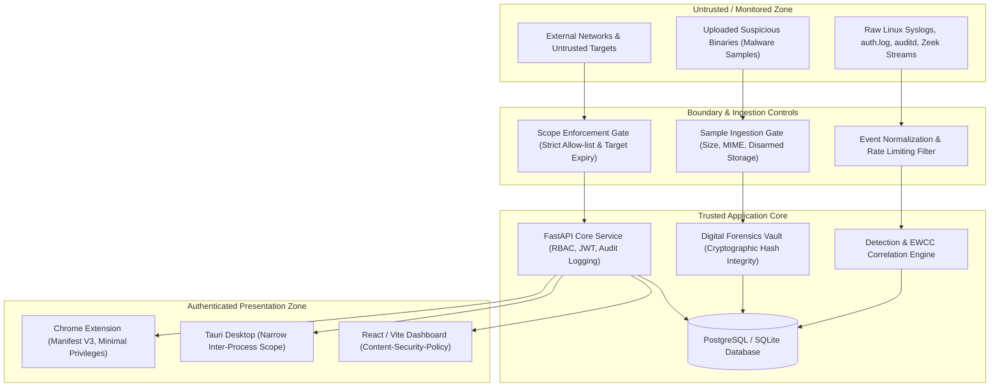

# SENTINEL-X — THREAT MODEL & DEFENSIVE SECURITY POSTURE
**Version:** 1.0  
**Classification:** Defensive Security Engineering Document  
**Date:** 2026-10-21  

---

## 1. System Overview & Trust Zones

SENTINEL-X is a unified, defensive cybersecurity platform integrating real-time threat detection, authorized vulnerability assessment, isolated malware triage, and digital forensics.

---

## 2. Threat Actor Taxonomy & Attack Vectors

| Actor / Profile | Motivation | Potential Vectors | Defensive Safeguards in SENTINEL-X |
| :--- | :--- | :--- | :--- |
| **Malicious Insider / Rogue Analyst** | Unauthorized access, evidence tampering, scope escape | Tampering with forensic records, scanning unauthorized IPs | Cryptographic chain of custody, immutable append-only audit trail, strict scope authorization gates, RBAC |
| **Compromised Monitored Endpoint** | Log blinding, event flooding, telemetry spoofing | Inundating ingestion endpoints, injecting fake events, terminating monitoring agent | Agent mutual authentication (Host API Keys), event deduplication, rate limiting, collector health heartbeats |
| **Malware Sample (Uploaded)** | Host compromise, VM breakout, persistence | Executable payload execution during static triage | Strict non-execution policy during static analysis, sandboxed isolated workers, file disarmament |
| **Untrusted Web Target (Assessment)** | Retaliation, SSRF trigger, reflected exploit | SSRF via target URL, malicious header response | Strict URI validation, exclusion of private IP ranges (`127.0.0.1`, `169.254.169.254`, `10.0.0.0/8`, etc.), rate limits |
| **Adversarial AI Input** | Prompt injection, data exfiltration | Embedding exploit strings or prompt overrides into log text | Strict JSON Schema validation, redaction of secrets, sandboxed execution, non-autonomous decision authority |

---

## 3. Core Defensive Safeguards & Architectural Invariants

### 3.1. Scope Gate Security (Non-Bypassable)
- All active assessment checks **MUST** pass through `assessment_service.validate_scope()`.
- Unregistered IP addresses, domains not matching authorized regexes, or targets whose written authorization date has passed are rejected immediately with HTTP 403 Forbidden.
- Loopback (`127.0.0.1`, `::1`), link-local, and RFC 1918 addresses require explicit administrator authorization to prevent Server-Side Request Forgery (SSRF).

### 3.2. Static Malware Triage Policy
- Suspicious binaries are stored with disarmed permissions (`chmod 0400` or read-only on disk) under non-executable storage directories.
- Triage processes do **NOT** invoke `exec()`, `system()`, or shell commands on uploaded binaries. All analysis utilizes stream parsing (PE/ELF header extractors, string extraction, byte entropy, hashing).
- Sandboxed dynamic analysis requires explicit out-of-band isolated VM provisioning.

### 3.3. Forensic Evidence Integrity & Custody
- Evidence files receive an immutable SHA-256 fingerprint upon intake.
- Any subsequent analytical transformation produces a derived artifact, preserving the pristine original.
- Every read, copy, export, and note operation is stamped with the analyst identity, UTC timestamp, and action description.

### 3.4. Least Privilege Extension & Desktop App
- Chrome extension uses Manifest V3 service workers, restricting execution to active tabs upon explicit user initiation (`activeTab`).
- Desktop app communicates via HTTPS/WSS to the backend and stores bearer tokens in encrypted operating system storage or memory sessions.
